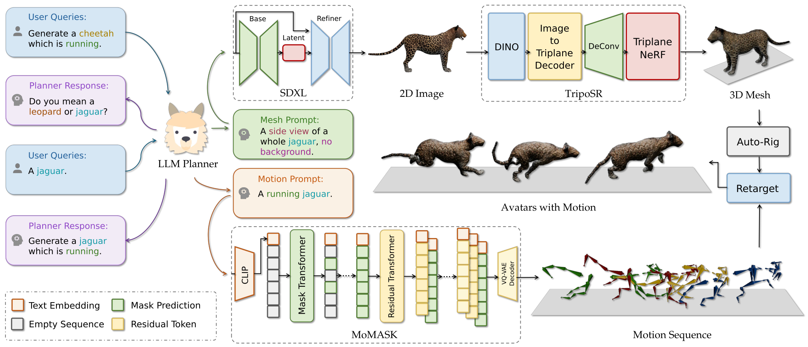

<div align="center"><h1> Motion Avatar: Generate Human and Animal Avatars with Arbitrary Motion <br>
  <sub><sup><a href="https://bmvc2024.org/">BMVC 2024</a></sup></sub> 
</h1>

[Zeyu Zhang](https://steve-zeyu-zhang.github.io)<sup>\*</sup>, [Yiran Wang](https://github.com/u7079256)<sup>\*</sup>, [Biao Wu](https://scholar.google.com/citations?user=Y3SBBWMAAAAJ&hl=en)<sup>\*</sup>, [Shuo Chen](https://www.linkedin.com/in/shuo-chen-7747a7246/), [Zhiyuan Zhang](https://github.com/Tiooo111), [Shiya Huang](https://github.com/gekelly), [Wenbo Zhang](https://zwbx.github.io/), [Meng Fang](https://mengf1.github.io/), [Ling Chen](https://profiles.uts.edu.au/Ling.Chen), [Yang Zhao](https://yangyangkiki.github.io/)<sup>✉</sup>

<sup>*</sup>Equal contribution
<sup>✉</sup>Corresponding author: y.zhao2@latrobe.edu.au

[](https://steve-zeyu-zhang.github.io/MotionAvatar/) [](https://arxiv.org/abs/2405.11286) [](https://huggingface.co/SteveZeyuZhang/Zoo-300K) [](https://paperswithcode.com/paper/motion-avatar-generate-human-and-animal) [](https://steve-zeyu-zhang.github.io/MotionAvatar/static/scholar.html)

</div>

_In recent years, there has been significant interest in creating 3D avatars and motions,
driven by their diverse applications in areas like film-making, video games, AR/VR, and
human-robot interaction. However, current efforts primarily concentrate on either generating the 3D avatar mesh alone or producing motion sequences, with integrating these
two aspects proving to be a persistent challenge. Additionally, while avatar and motion
generation predominantly target humans, extending these techniques to animals remains
a significant challenge due to inadequate training data and methods. To bridge these gaps,
our paper presents three key contributions. Firstly, we proposed a novel agent-based approach named <b>Motion Avatar</b>, which allows for the automatic generation of high-quality
customizable human and animal avatars with motions through text queries. The method
significantly advanced the progress in dynamic 3D character generation. Secondly, we
introduced a <b>LLM planner</b> that coordinates both motion and avatar generation, which
transforms a discriminative planning into a customizable Q&A fashion. Lastly, we presented an animal motion dataset named <b>Zoo-300K</b>, comprising approximately <b>300,000</b>
text-motion pairs across <b>65</b> animal categories and its building pipeline <b>ZooGen</b>, which
serves as a valuable resource for the community._



> [!NOTE]
> Part of the code and data are still very useful. However, some parts of the off-the-shelf model are outdated. We suggest replacing them with the latest pretrained model to achieve state-of-the-art performance.


## News
<b>(07/19/2024)</b> &#127881; Our paper has been accepted to <a href="https://bmvc2024.org/"><b>BMVC 2024</b></a>!<br>
<b>(05/23/2024)</b> &#127881; Our paper has been promoted by <a href="https://twitter.com/ai_bites/status/1792907754727744000"><b>AI Bites</b></a>!<br>
<b>(05/22/2024)</b> &#127881; Our paper has been promoted by <a href="https://www.reddit.com/r/languagemodeldigest/comments/1cxqebo/create_3d_avatars_with_text_prompts_with_this_new/"><b>Language Model Digest</b></a>!<br>
<b>(05/21/2024)</b> &#127881; Our paper has been promoted by <a href="https://x.com/CSVisionPapers/status/1792975365842817444"><b>CSVisionPapers</b></a>!

## Code Overview

This repository contains the code for the main stages of the Motion Avatar pipeline. Each component is a self-contained sub-project with its own README, environment, and usage instructions:

| Directory | Role in the pipeline |
|---|---|
| [`motion_synthesis/`](motion_synthesis/) | **Animal motion data synthesis** — per-motion SinMDM diffusion models for animal motion augmentation (in-betweening / expansion editing), BVH↔npy conversion utilities, and batch training driver used to build [Zoo-300K](https://huggingface.co/SteveZeyuZhang/Zoo-300K) |
| [`motion_generation/`](motion_generation/) | **Motion generation** — MoMask-based text-to-motion training, evaluation, and inference (RVQ-VAE + masked/residual transformers), same recipe for human and animal motion |
| [`motion_evaluator/`](motion_evaluator/) | **Evaluator training** — trains the text-motion-matching evaluator networks (for R-precision / FID / MM-Dist metrics), extended to arbitrary skeletons via a 6D-rotation representation so it can be trained on animal motion data |
| [`avatar_generation/`](avatar_generation/) | **Avatar generation** — text → SDXL image → Grounded-SAM segmentation → TripoSR image-to-3D mesh (plus a legacy OpenLRM variant) |
| [`blender/retarget/`](blender/retarget/) | **Rigging & retargeting** — retargets a BVH motion onto a rigged FBX avatar via Blender + Auto-Rig Pro, with per-species bone-map presets |
| [`blender/render/`](blender/render/) | **Rendering** — headless Blender scripts to render animated FBX files or .blend scenes to video |

### Pipeline at a glance

1. **Animal motion data synthesis** — train one SinMDM model per Truebones Zoo clip, synthesize augmented variants, and convert them to training features:
   ```bash
   cd motion_synthesis
   bash sequential_training.sh -b dataset/zoo -s ckpt_samples -n 60000 -d 0
   python -m sample.edit --model_path ckpt_samples/Jaguar/Attack/model000059999.pt --edit_mode in_betweening --prefix_end 0.25 --suffix_start 0.75
   python bvh2vec.py <bvh_folder>
   ```
2. **Motion generation** — three-stage MoMask training (the same recipe trains human and animal motion), then text-to-motion inference:
   ```bash
   cd motion_generation
   python train_vq.py --name rvq_bs512 --gpu_id 0 --dataset_name t2m --batch_size 512 --num_quantizers 6 --max_epoch 50 --quantize_dropout_prob 0.2 --gamma 0.05
   python train_t2m_transformer.py --name mtrans_bs64 --gpu_id 0 --dataset_name t2m --batch_size 64 --vq_name rvq_bs512
   python train_res_transformer.py --name rtrans_bs64 --gpu_id 0 --dataset_name t2m --batch_size 64 --vq_name rvq_bs512 --cond_drop_prob 0.2 --share_weight
   python gen_t2m.py --gpu_id 0 --ext exp1 --text_prompt "A person is walking on a treadmill." --motion_length 0
   ```
3. **Avatar generation** — text prompt to 3D mesh:
   ```bash
   cd avatar_generation
   python tri_main_t2i.py --prompt "a golden retriever" --mesh_name result_mesh
   ```
4. **Rigging & retargeting** — rig the mesh with Auto-Rig Pro (in the Blender GUI), then retarget a generated motion onto it:
   ```bash
   blender -b -P blender/retarget/retarget.py -- -fbx <rigged_avatar.fbx> -t <motion.bvh> -s 0 -e 200 -o output.fbx -a Jaguar
   ```
5. **Rendering** — render the animated avatar to video:
   ```bash
   blender --background --python blender/render/render_fbx.py -- --fbx output.fbx --output render_output
   ```

See each component's README for environment setup, dataset preparation, and the full set of options.

### Data

For animal motion, there are two options:

- **Use the ready-made dataset** — **Zoo-300K** is released on [Hugging Face](https://huggingface.co/SteveZeyuZhang/Zoo-300K), organized per animal category.
- **Or bring your own** — generate the animal motions you want yourself (see [`motion_synthesis/`](motion_synthesis/)) or use your own animal motion data, then align it into training features with the conversion chain used by ZooGen: `motion_synthesis/utils/fbx2bvh.py` (FBX → BVH) → `motion_synthesis/bvh2npy.py` / `motion_synthesis/bvh2vec.py` (BVH → per-joint feature arrays) → `motion_synthesis/mean_std.py` (dataset Mean/Std and evaluator meta). See [`motion_synthesis/README.md`](motion_synthesis/README.md) for details.

Notes:

- The raw **Truebones Zoo** source motions are commercially licensed and are **not** redistributed in this repository; obtain them from [Truebones](https://truebones.gumroad.com/).
- Human motion uses **HumanML3D**; follow the [HumanML3D](https://github.com/EricGuo5513/HumanML3D) instructions and see `motion_generation/`.

### Requirements

- `blender/retarget/` requires [Auto-Rig Pro](https://blendermarket.com/products/auto-rig-pro), a paid Blender add-on.
- Retargeting requires Blender ~4.0; rendering requires Blender ~2.93.
- The pinned conda environments require Linux.

## Acknowledgements

Our code builds upon several excellent open-source projects: [MoMask](https://github.com/EricGuo5513/momask-codes), [text-to-motion](https://github.com/EricGuo5513/text-to-motion), [SinMDM](https://github.com/SinMDM/SinMDM), [TripoSR](https://github.com/VAST-AI-Research/TripoSR), [OpenLRM](https://github.com/3DTopia/OpenLRM), [generative-models (SDXL)](https://github.com/Stability-AI/generative-models), [Grounded-Segment-Anything](https://github.com/IDEA-Research/Grounded-Segment-Anything), and [TEMOS](https://github.com/Mathux/TEMOS). Forked components retain their upstream licenses (see the `LICENSE` file inside each directory). Animal source motions are from [Truebones Zoo](https://truebones.gumroad.com/), and rigging uses [Auto-Rig Pro](https://blendermarket.com/products/auto-rig-pro).

## Citation

```
@article{zhang2024motionavatar,
  title={Motion Avatar: Generate Human and Animal Avatars with Arbitrary Motion},
  author={Zhang, Zeyu and Wang, Yiran and Wu, Biao and Chen, Shuo and Zhang, Zhiyuan and Huang, Shiya and Zhang, Wenbo and Fang, Meng and Chen, Ling and Zhao, Yang},
  journal={arXiv preprint arXiv:2405.11286},
  year={2024}
}
```
